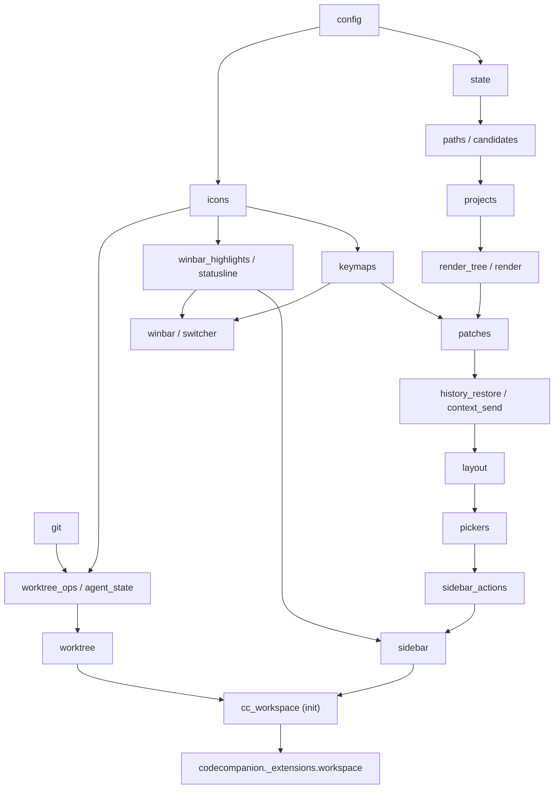

# AGENTS.md

`cc-workspace.nvim` is a standalone Neovim (`>= 0.11`, LuaJIT) multi-project, Git-worktree-aware AI Agent Workspace plugin and `CodeCompanion.nvim` extension (`olimorris/codecompanion.nvim` `v20.1.0` + `ravitemer/codecompanion-history.nvim`), mounted directly by `lazy.nvim` from this repository.

## Critical Safety Rules

1. **Never Touch Live User Data During Verification or Reproduction**
   - Live user persistence paths on this machine:
     - `~/.local/share/nvim/cc-workspace-projects.json` (`stdpath("data")/cc-workspace-projects.json`)
     - `~/.local/share/nvim/cc-worktrees/` (`stdpath("data")/cc-worktrees/`)
     - `~/.local/share/nvim/codecompanion-history/` (`stdpath("data")/codecompanion-history/`)
   - Every headless test, screenshot capture, ad-hoc `nvim --headless` check, or reproducer MUST redirect state to a temporary directory via `ws.setup({ projects_file = tmp_projects, worktrees_base_dir = tmp_wt })`, `ws.set_projects_file(tmp_projects)`, and `wt.set_worktrees_base_dir(tmp_wt)` (or isolated `XDG_*` env vars), clean up `tmp_root` on exit, and verify live file SHA-256 hashes remain unchanged.
2. **Preserve Human Git Authorship, Commit Discipline & Shell Safety**
   - Inherit the local Git `user.name` and `user.email` unchanged; never override `--author`, `GIT_AUTHOR_*`, or `GIT_COMMITTER_*`.
   - Never invoke bare `cat` in shell commands (locally aliased to `bat`); never bypass Git hooks (`--no-verify`) without explicit user confirmation; never run unbounded `find ~` / `find /` / `find /Users` scans.
   - Follow the mandatory 3-paragraph `-m` Conventional Commits and `Co-Authored-By` specification in [Git Commit, Shell & Multi-Agent Conventions](#git-commit-shell--multi-agent-conventions).

## Repository Layout

```text
lua/
  cc_workspace/
    config.lua             Option schema (CcWorkspaceConfig), KEYMAP_SCHEMA & defaults
    icons.lua              Category/spaced Nerd Font icon proxy tables
    state.lua              Workspace singleton state, highlight groups & width helpers
    git.lua                Pure-Lua .git/worktree/HEAD/porcelain readers & async git runner
    worktree_ops.lua       Bounded async worktree list/refresh, create & safe remove ops
    agent_state.lua        Orca/Herdr agent lifecycle state machine, rollups & toasts
    worktree.lua           Backwards-compatible worktree + agent_state facade & autocmds
    paths.lua              Safe path normalization, window-local lcd & ancestor disambiguation
    candidates.lua         Async zoxide cache warming & candidate project discovery
    projects.lua           JSON project store CRUD, chat ownership & paths/candidates facade
    render_tree.lua        PROJECTS -> Git Worktree -> chat tree builder & dynamic footer
    render.lua             Header, AGENTS section, coalesced scheduler & diff-checked writer
    keymaps.lua            Dynamic keymap engine, live set_keymaps() & show_keys() inspector
    patches.lua            Idempotent CodeCompanion v20.1.0, history & persisted.nvim patches
    history_restore.lua    Per-cwd buffer_context scoping & saved history chat restoration
    context_send.lua       Visual selection capture/forwarding & code-tab side chat toggle
    layout.lua             2-pane workspace tab/window lifecycle & chat management facade
    pickers.lua            Telescope & vim.ui.input project/worktree pickers
    sidebar_actions.lua    Sidebar rename, delete, K inspect, y/Y path yank & keyword filter
    sidebar.lua            Sidebar navigation, mouse hit-testing, dynamic keys & ? cheatsheet
    winbar_highlights.lua  Theme-adaptive CcWinbar* palette & display-cell truncation
    winbar.lua             Standalone clickable multi-chat pill winbar (<= 7 pills)
    statusline.lua         Reusable lualine component & cc-workspace filetype extension
    switcher.lua           Live-updating floating agent switcher (<leader>cl) & attention jump
    init.lua               Public cc_workspace facade, lazy submodule index & 5 user commands
  codecompanion/_extensions/workspace/
    init.lua               CodeCompanion extension adapter (exports cc_workspace)
docs/
  images/                  2x Retina UI screenshots embedded in README.md
tests/
  run_headless.lua         Main deterministic 0-network headless E2E entrypoint & harness
  test_keymaps_and_lint.lua Winbar multi-width, embed mouse, dynamic keymaps & linter suite
  test_commit_msg.lua      Conventional Commit, 3-part -m, Co-Authored-By & hook E2E suite
scripts/
  check.sh                 Unified hygiene, StyLua, AST/DAG, LuaLS, commit-msg & E2E runner
  lint_repo.lua            Treesitter AST, <=800L ceiling, 0-cycle DAG & global hygiene linter
  lint_markdown.lua        Frontmatter, .agents/{rules,skills}, relative link & Mermaid linter
  lint_commit_msg.lua      Conventional Commits, 3-paragraph -m, bat hygiene & Co-Authored-By linter
.agents/
  rules/                   Contextual & always-on agent rules (.claude/rules symlinked)
  skills/                  Procedural workflow skills (.claude/skills symlinked)
.luarc.json                LuaLS workspace configuration (LuaJIT)
.pre-commit-config.yaml    Local pre-commit, commit-msg & pre-push quality gates
cliff.toml                 Conventional Commits changelog parser specification
stylua.toml                StyLua formatting specification
```

## Module Dependency DAG

Top-level `require()` statements in `lua/` MUST form a strict **0-cycle DAG** (enforced by [scripts/lint_repo.lua](./scripts/lint_repo.lua)). Leaf modules (`config`, `icons`, `state`, `git`, `worktree_ops`, `agent_state`, `worktree`, `winbar_highlights`, `winbar`, `statusline`, `switcher`, `keymaps`) MUST NOT top-level `require("cc_workspace")`; cross-branch calls MUST remain deferred inside functions via `pcall(require, ...)`.



## Verification & Quality Gates

Run checks through [scripts/check.sh](./scripts/check.sh) (automatically resolves `nvim` and Mason tools under `~/.local/share/nvim/mason/bin` even in minimal non-interactive `PATH` environments):

```sh
./scripts/check.sh              # Full gate: hygiene + fmt + arch + lsp + isolated E2E tests
./scripts/check.sh lint         # Fast static gates only: hygiene + fmt + arch + lsp
./scripts/check.sh hygiene      # Text hygiene, JSON, shfmt & binary PNG/JPEG/WebP header validation
./scripts/check.sh fmt          # Check Lua formatting against stylua.toml
./scripts/check.sh fmt --fix    # Auto-format Lua (stylua) and shell scripts (shfmt)
./scripts/check.sh arch         # <=800L ceiling, Treesitter AST, 0-cycle DAG, globals & docs lint
./scripts/check.sh commit-msg <msg-file> # Validate Conventional Commit, 3-part -m & Co-Authored-By
./scripts/check.sh lsp          # lua-language-server --check at Warning level with $VIMRUNTIME
./scripts/check.sh test         # Isolated headless E2E + dynamic keymaps + nvim --embed mouse suite
pre-commit install              # Install local pre-commit, commit-msg, and pre-push Git hooks
pre-commit run --all-files      # Run all configured Git hooks across tracked files
```

Before claiming any code or documentation task is complete, run `./scripts/check.sh` and confirm `0` errors and `0` warnings.

## Coding & Architectural Conventions

- **Strict Modularity (`<= 800` Lines per `.lua` File)**:
  - Every `.lua` file across `lua/`, `scripts/`, and `tests/` MUST remain **`<= 800` physical lines** (after `stylua` formatting). Enforced automatically by `M.check_lua_line_limit` in [scripts/lint_repo.lua](./scripts/lint_repo.lua). Decompose growing modules along single-responsibility boundaries while keeping public facade exports backwards-compatible.
- **Formatting (`stylua.toml`)**: Tabs (`indent_width = 4`), `column_width = 120`, Unix `LF` line endings, `quote_style = "AutoPreferDouble"`, `call_parentheses = "Always"`, and a single trailing newline per text file.
- **Static Typing (`LuaLS`)**: Annotate module exports, config tables, and non-trivial structures with EmmyLua (`---@class`, `---@field`, `---@param`, `---@return`, `---@type`). Keep `lua-language-server --check` at **0 warnings** (`--checklevel=Warning`). Do not add blanket file-level `---@diagnostic disable` directives.
- **Modern Neovim APIs**: Target Neovim `>= 0.11` / `0.12`. Use `vim.uv` (never `vim.loop`), `vim.api.nvim_buf_set_extmark` (never `nvim_buf_add_highlight`), `vim.bo` / `vim.wo` (never `nvim_buf_get_option` / `nvim_win_set_option`), and `vim.islist` (never `vim.tbl_islist`).
- **Dynamic Keymaps & Discovery (`config.lua`, `keymaps.lua`, `sidebar.lua`)**:
  - Register all user-bindable actions in `config.KEYMAP_SCHEMA` (`global`, `sidebar`, `chat`, `switcher`), supporting `string`, `string[]` aliases, or `false` to disable.
  - Track applied mappings via `vim.b[buf]._cc_ws_bound_keys` and `_bound_global_keys` so `cc_workspace.set_keymaps(overrides)` and `:CodeCompanionWorkspaceKeys` (`<C-r>`) hot-update live buffers, sidebar footers, and floating cheatsheets cleanly without stale bindings.
- **Non-Blocking UI & Bounded Async Git**:
  - Synchronous render paths (`render.lua`, `render_tree.lua`, `winbar.lua`, `statusline.lua`, `switcher.lua`) MUST NEVER spawn blocking subprocesses (`vim.fn.system`, `io.popen`, `os.execute`, or `:wait()`). Render immediately from pure-Lua/libuv `.git` inspection (`git.lua`) and cached state, then schedule coalesced async refreshes (`worktree_ops.lua`).
  - Asynchronous `git` commands in `git.lua` / `worktree_ops.lua` MUST run with `GIT_TERMINAL_PROMPT=0` and `GIT_OPTIONAL_LOCKS=0`, enforce concurrency caps (`MAX_CONCURRENT_GIT_REFRESH`), guard `vim.in_fast_event()` with `vim.schedule(...)`, and guarantee timer/process cleanup via `SIGKILL` watchdogs.
  - Always `:stop()` and `:close()` (`if not timer:is_closing()`) `vim.uv.new_timer()` handles when animations go idle or floats close.
- **Per-Chat CWD & Path Hygiene**:
  - Never mutate global Neovim working directory (`:cd`) for chat buffers; scope chats via window-local `lcd` (`paths.sync_win_lcd`) or transient `paths.with_temp_cwd`.
  - Never pass arbitrary user or repository paths to `vim.fn.expand()` (avoids wildcard, `%`, and `#` expansion hazards); use `paths.expand_raw_dir_path`, `paths.normalize_project_path`, or `git.normalize_path`.
- **Global Namespace & Display Width Hygiene**:
  - Never leak globals onto `_G` (including legacy `_G._user_cc_*` names). Winbar `%@...@` click callbacks MUST use module-scoped `v:lua.require'cc_workspace.winbar'.<handler>`.
  - Measure and truncate visible UI strings with `vim.fn.strdisplaywidth` / `vim.api.nvim_strwidth` (CJK & Nerd Font safe), never byte length `#s` (reserve `#s` for byte-indexed highlight spans). Winbar output evaluated via `nvim_eval_statusline` must never exceed `nvim_win_get_width(win)` down to `columns = 62`.
- **Idempotent Upstream Patches (`patches.lua`)**:
  - Save original functions under `_cc_ws_orig_<name>` before wrapping so repeated `setup()` or lazy reloads never double-wrap `codecompanion.nvim` (`v20.1.0`), `codecompanion-history.nvim`, or `persisted.nvim`.
- **Synchronized Documentation & Tests**:
  - Keep [README.md](./README.md), `KEYMAP_SCHEMA` & `CcWorkspaceConfig` in [lua/cc_workspace/config.lua](./lua/cc_workspace/config.lua), [lua/cc_workspace/keymaps.lua](./lua/cc_workspace/keymaps.lua), [tests/run_headless.lua](./tests/run_headless.lua), and [tests/test_keymaps_and_lint.lua](./tests/test_keymaps_and_lint.lua) aligned whenever commands, options, or keymaps change.

## Git Commit, Shell & Multi-Agent Conventions

All AI coding agents (`Antigravity` / `agy`, `Claude Code`, `Oh-My-Pi` / `omp`, `Codex` / `GPT`, `Cursor`, `CodeCompanion`, etc.) MUST strictly obey the following Git and shell rules (mechanically enforced by [scripts/lint_commit_msg.lua](./scripts/lint_commit_msg.lua) and the `commit-msg` hook in [.pre-commit-config.yaml](./.pre-commit-config.yaml)):

### 1. Ban Bare `cat` & Enforce 3-Paragraph `-m` Structure

- **Background**: `cat` is aliased to `bat` in the local shell environment, injecting line numbers, `STDIN` headers, and `STDIN ─────────` box borders into standard output.
- **Mandatory Rules**:
  1. **Never** use `cat <<'EOF'` or `cat` pipelines to construct commit messages or write files.
  2. Structure every `git commit` into the **standard 3-paragraph (`-m`) layout** (exactly 3 `-m` flags: 1st `-m` for the subject header, 2nd `-m` for the newline-separated bulleted body list, 3rd `-m` for the `Co-Authored-By` trailer). **Never allocate a separate `-m` per bullet point** (Git inserts a blank line between each `-m`, producing sparse multi-paragraph lists); combine all `- ...` bullets inside a single `-m` argument separated by newlines (or `$'...'`).
  3. Read files with dedicated agent/editor file-reading tools (`Read` / `view_file` / `read_file`), never bare `cat`. When invoking `cat` in a shell script or pipeline is strictly necessary, escape it as `\cat` or `/bin/cat`.

### 2. Git Authorship & AI Co-Authorship Attribution (Human Sovereignty + AI Audit)

- **Ownership Principle**: The human developer operating the session is always the primary owner and sole `Author` & `Committer` (preserving `git blame` accountability and GitHub contribution attribution). AI pair-programming contributions are audited exclusively via the standard `Co-Authored-By` trailer.
- **Mandatory Rules**:
  1. **Human Author & Committer**: Inherit local `user.name` and `user.email` unchanged when running `git commit`; **never** override authorship via `--author`, `GIT_AUTHOR_*`, `GIT_COMMITTER_*`, or `git config`.
  2. **Mandatory AI Trailer**: Append `Co-Authored-By: <Model> <email>` as the 3rd `-m` paragraph on every AI-assisted commit.
  3. **Base Model Family Name Only**: Use **only** the underlying base model family name (`Claude`, `Gemini`, `GPT`, `DeepSeek`). **Never** include version numbers, sub-model tiers, or outer client/harness names (regardless of whether invoked through `Antigravity`, `agy`, `Oh-My-Pi (omp)`, `Claude Code`, or `Cursor`, never write `Gemini 3.8 Flash`, `Gemini 2.5 Pro`, `Claude 3.7 Sonnet`, `Claude Opus 4.6`, `GPT-5`, `Codex`, `Oh-My-Pi`, `Antigravity`, etc.).
  4. **Official Vendor Noreply Emails**:
     - Anthropic Claude series: `Co-Authored-By: Claude <noreply@anthropic.com>`
     - Google Gemini series: `Co-Authored-By: Gemini <218195315+gemini-cli@users.noreply.github.com>`
     - OpenAI GPT / Codex series: `Co-Authored-By: GPT <noreply@openai.com>`
     - DeepSeek series: `Co-Authored-By: DeepSeek <noreply@deepseek.com>`
  5. **Standard Commit Command Template**:
     ```sh
     git commit -m "<type>(<scope>): <subject>" \
       -m "- <change 1>
     - <change 2>" \
       -m "Co-Authored-By: <Model> <email>"
     ```

### 3. Conventional Commits Format (Synced with `cliff.toml`)

- Follow `<type>(<scope>): <subject>` (comma-separated multi-scopes `<type>(<s1>,<s2>): <subject>` are supported; cross-module or repository-wide changes may omit `(<scope>)`, i.e., `<type>: <subject>`).
- **Allowed `type` values** (strictly aligned with [cliff.toml](./cliff.toml) and [scripts/lint_commit_msg.lua](./scripts/lint_commit_msg.lua)):
  - `feat`: New feature
  - `fix`: Bug fix
  - `refactor`: Code refactoring (neither feature nor bug fix)
  - `perf`: Performance optimization
  - `docs`: Documentation change
  - `style`: Formatting or style adjustment (no logic change)
  - `test`: Add or update tests
  - `build`: Build/packaging or external dependency change
  - `ci`: Continuous integration or workflow/script change
  - `chore`: Tooling, agent rules/skills, hooks, or routine maintenance
  - `revert`: Revert a previous commit
- **Recommended `scope` values for `cc-workspace.nvim`**:
  - **Plugin modules**: `config`, `icons`, `state`, `git`, `worktree`, `worktree_ops`, `agent`, `agent_state`, `paths`, `candidates`, `projects`, `render`, `render_tree`, `keymaps`, `patches`, `history`, `history_restore`, `context`, `context_send`, `layout`, `pickers`, `sidebar`, `sidebar_actions`, `winbar`, `winbar_highlights`, `statusline`, `switcher`, `init`, `extension`
  - **Engineering & maintenance**: `lint`, `test`, `docs`, `agent`, `hooks`, `ci`, `deps`, `release`

### 4. Multi-Agent Worktree Isolation & Git Safety

1. **Project-Internal Worktree Isolation**:
   - For concurrent multi-agent tasks, experimental features, or cross-module refactors, isolate work inside `.worktrees/{name}` under the repository root (avoiding out-of-workspace file access blocks while keeping parent directories clean):
     ```sh
     git worktree add .worktrees/{name} -b feat/{YYYYMMDDHHmmss}-{name}
     ```
   - When using Claude Code native worktree mode, run `claude -w {name}` (`.claude/worktrees/{name}`).
   - Always check `git branch --show-current` before editing files to confirm branch alignment.
2. **Module Boundaries & Destructive Git Command Ban**:
   - Modify only files within the assigned task scope; do not perform unrelated repo-wide rewrites unless requested.
   - Without explicit user confirmation, **never** run `git reset --hard`, `git clean -fd`, `git checkout -- .`, `git restore .`, `git push --force`, or `git commit --no-verify`.

### 5. Ban Unbounded Home / Root Directory Scans (macOS TCC & Watchdog Safety)

- **Background**: In non-interactive background daemons and headless agent sessions (`agy`, `pi`, `omp`, Multica daemon) on macOS, recursive scans across `~`, `/Users`, or `/` touch `~/Library`, cloud mounts, and macOS TCC-protected directories (`~/Desktop`, `~/Documents`, `~/Downloads`), permanently blocking child processes until `idle_watchdog` kills them (`exit 137`).
- **Mandatory Rules**:
  1. **Never** run `find ~`, `find /`, `find /Users`, or unbounded recursive searches across `$HOME` (`grep -R ~`, `rg ... ~`).
  2. Restrict code and config searches to the current repository/worktree; if inspecting local tool caches (e.g., `~/.local/share/nvim/mason`) is strictly needed, target the exact cache subdirectory with an explicit `-maxdepth` bound.

## Workspace Rules & Skills

- **Rules (`.agents/rules/`)**:
  - [data-safety-and-workflow.md](./.agents/rules/data-safety-and-workflow.md) — Always-on live data protection, gate discipline, and Git hygiene.
  - [lua-neovim-standards.md](./.agents/rules/lua-neovim-standards.md) — `<= 800` line modularity, LuaJIT, DAG, non-blocking UI, CWD, and LuaLS invariants (`*.lua`).
  - [codecompanion-patches.md](./.agents/rules/codecompanion-patches.md) — Upstream `v20.1.0` monkey-patching and session safety (`patches.lua`, `layout.lua`, `history_restore.lua`, `context_send.lua`).
  - [testing-invariants.md](./.agents/rules/testing-invariants.md) — Deterministic headless, dynamic keymap, and `--embed` E2E test standards (`tests/`, `scripts/`).
- **Skills (`.agents/skills/`)**:
  - [ccw-verify-and-lint](./.agents/skills/ccw-verify-and-lint/SKILL.md) — Run lint/type/E2E gates, diagnose failures, and author isolated regression tests.
  - [ccw-codecompanion-patch](./.agents/skills/ccw-codecompanion-patch/SKILL.md) — Audit, extend, or upgrade `codecompanion.nvim` `v20.1.0` & history monkey-patches safely.
  - [ccw-ui-and-worktree](./.agents/skills/ccw-ui-and-worktree/SKILL.md) — Extend sidebar/winbar/statusline/switcher chrome, dynamic keymaps, and async Git worktree flows.

Note: `CLAUDE.md`, `.claude/rules`, and `.claude/skills` symlink directly to `AGENTS.md`, `.agents/rules`, and `.agents/skills`. Always edit the canonical `.agents/` and `AGENTS.md` files.
