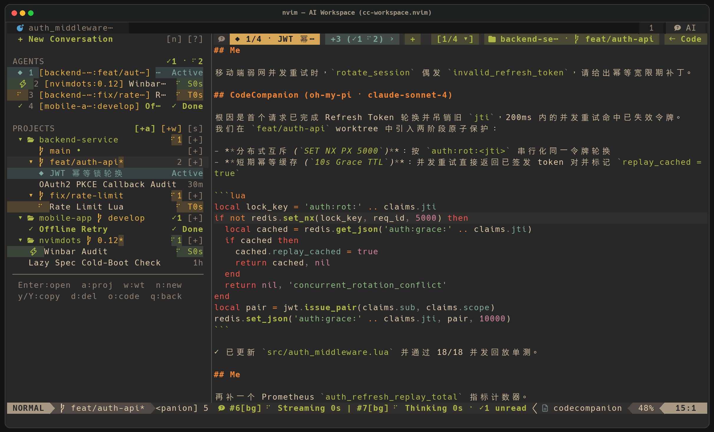
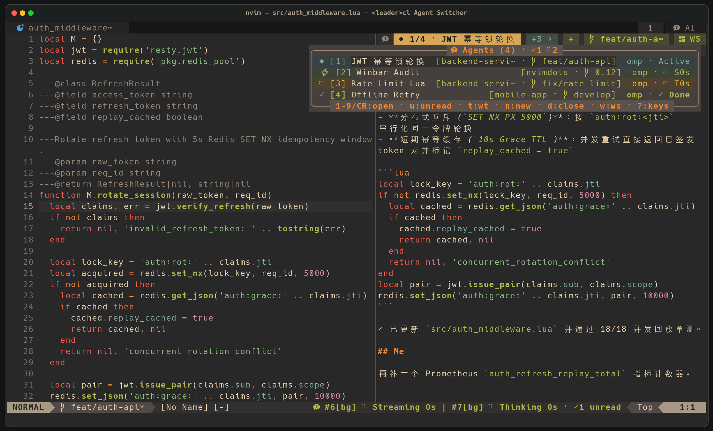
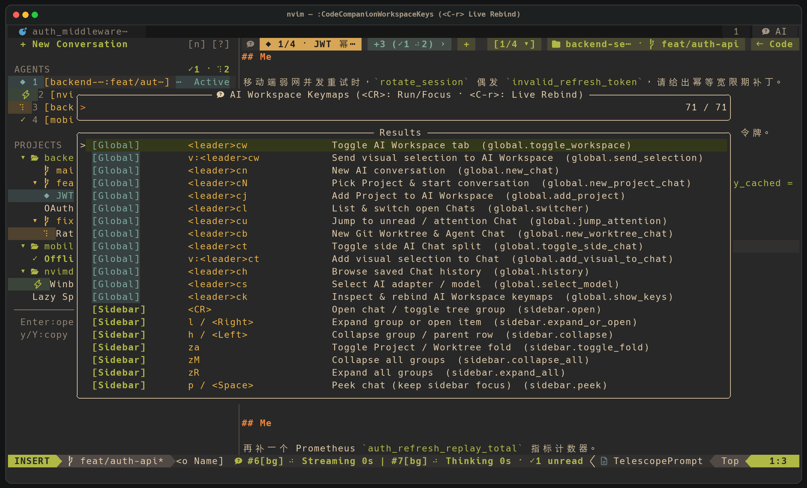

# cc-workspace.nvim

> **Personal Plugin Notice**: `cc-workspace.nvim` is a personal Neovim workspace, Git worktree, and multi-agent chrome extension built specifically against **`olimorris/codecompanion.nvim` `v20.1.0`** (with `ravitemer/codecompanion-history.nvim`). Internal monkey-patches target `v20.1.0` ACP, HTTP tool runtime, session serializer, and history UI internals.

An Orca / Herdr-inspired multi-project, Git-worktree-aware AI Agent Workspace for [CodeCompanion.nvim](https://github.com/olimorris/codecompanion.nvim).

## Screenshots

### 1. Dedicated 2-Pane AI Workspace (`:CodeCompanionWorkspace` / `<leader>cw`)

Orca-style `AGENTS` + `PROJECTS` / Git Worktree sidebar on the left, high-contrast gold active Winbar pill + sibling status pills + per-worktree isolated AI chat on the right, and live background agent rollups in `lualine`:



### 2. Side Chat + Live Floating Agent Switcher (`<leader>cl`)

Switch seamlessly between active, streaming (`⚡`), thinking (`⠋`), and completed unread (`✓`) agent sessions across repositories and linked Git worktrees without leaving your code buffer:



### 3. Unified Keymaps Explorer & Live Rebinding (`:CodeCompanionWorkspaceKeys` / `<leader>ck`)

Search every `[Global]`, `[Sidebar]`, `[Chat]`, `[Switcher]`, `[Winbar Mouse]`, and `[Commands]` shortcut, press `<CR>` to execute/focus, or press `<C-r>` to dynamically rebind any key at runtime:



## Features

- **Dedicated 2-Pane AI Workspace Tab (`:CodeCompanionWorkspace`)**:
  - Left `cc-workspace` tree sidebar grouping active & saved conversations under **Projects -> Git Worktrees -> Conversations**, with ancestor-aware name disambiguation, keyword filtering (`f` / `F`), and live 250ms spinner rollups.
  - Right main chat pane with automatic window-local `lcd` isolation so simultaneously open chats across different repositories or worktrees never collide.
- **Non-Blocking Git Worktree Engine (`cc_workspace.worktree`)**:
  - Zero-subprocess pure-Lua/libuv `.git` & linked worktree discovery for instant sidebar/winbar rendering, paired with bounded async `git worktree list --porcelain` + `git status --porcelain` refreshes.
  - Interactive worktree branch picker (`w` / `:CodeCompanionWorkspaceWorktree`) creating clean worktrees under `stdpath("data")/cc-worktrees/<repo>-<hash6>/<branch>` and spawning an agent chat directly inside.
- **Unified Agent Lifecycle & Notifications**:
  - Tracks `thinking` (`⠋`), `streaming` (`⚡`), `waiting` (``), `unread` (`✓`), `error` (`✗`), `active` (`◆`), and `idle` (`○`) states across all open chats with background completion/approval/error toasts (`:CodeCompanionNotificationsToggle`) and one-key jump-to-attention (`u`).
- **Standalone High-Contrast Chat Winbar (`cc_workspace.winbar`)**:
  - Clickable multi-chat pills (width-safe `<= 7` pagination with off-screen attention rollups), `[+]` new chat, ` project ·  branch` badge, and `󰕮 WS` / `󰌍 Code` toggle — decoupled from `lualine.nvim`.
- **Dynamic Keymaps & Searchable Inspector (`cc_workspace.keymaps`)**:
  - Customize every `global`, `sidebar`, `chat`, and `switcher` action via `opts.keymaps` or hot-update open buffers on the fly with `require("cc_workspace").set_keymaps(...)` and `:CodeCompanionWorkspaceKeys`.
- **Per-Chat CWD & Session Safety Patches**:
  - Scopes CodeCompanion ACP jobs/RPCs, HTTP tool execution, system prompts, and `codecompanion-history` saves to each chat's `chat.opts.cwd`, and guards `persisted.nvim` against saving transient workspace/chat layouts.

## Installation (`lazy.nvim`)

Supports conditional local development directory fallback alongside the GitHub repository spec (safe in headless/Docker environments without `dev = true`):

```lua
local cc_ws_dir = vim.fn.expand("~/Documents/code/cc-workspace.nvim")

return {
	{
		"double12gzh/cc-workspace.nvim",
		dir = vim.uv.fs_stat(cc_ws_dir) and cc_ws_dir or nil,
		lazy = true,
		cmd = {
			"CodeCompanionWorkspace",
			"CodeCompanionWorkspaceAddProject",
			"CodeCompanionWorkspaceWorktree",
			"CodeCompanionWorkspaceKeys",
			"CodeCompanionNotificationsToggle",
		},
		opts = {},
	},
	{
		"olimorris/codecompanion.nvim",
		dependencies = {
			"nvim-lua/plenary.nvim",
			"ravitemer/codecompanion-history.nvim",
			"double12gzh/cc-workspace.nvim",
		},
		opts = {
			extensions = {
				workspace = {
					enabled = true,
					callback = "codecompanion._extensions.workspace",
					opts = {
						sidebar_width = 38,
						notifications = true,
					},
				},
			},
		},
	},
}
```

### Lualine Integration

```lua
local cc_status = require("cc_workspace.statusline")
table.insert(opts.sections.lualine_x, 1, cc_status.component())
table.insert(opts.extensions, cc_status.extension())
```

## Keymaps & Commands Cheat Sheet

### User Commands

| Command | Description |
| :--- | :--- |
| `:CodeCompanionWorkspace [dir]` | Toggle the AI Workspace tab (or add & open `[dir]`) |
| `:CodeCompanionWorkspaceAddProject [dir]` | Add a project directory via picker or path argument |
| `:CodeCompanionWorkspaceWorktree [dir]` | Create/select a Git worktree and start an Agent chat in it |
| `:CodeCompanionWorkspaceKeys [picker\|float]` | Search, execute (`<CR>`), and live-rebind (`<C-r>`) all Workspace keymaps |
| `:CodeCompanionNotificationsToggle` | Toggle background agent completion/attention toast notifications |

### Global `<leader>c*` Shortcuts (Opt-In / Recommended `nvimdots` Preset)

`opts.keymaps.global` defaults to `{}` so `cc-workspace.nvim` never clobbers your editor mappings unless opted in, while `:CodeCompanionWorkspaceKeys` automatically discovers any external `<leader>c*` mappings calling `cc_workspace`:

| Key | Mode | `opts.keymaps.global` Action | Description |
| :--- | :--- | :--- | :--- |
| `<leader>cw` / `<leader>cW` | `n` | `toggle_workspace` | Toggle dedicated 2-pane AI Workspace tab |
| `<leader>cw` / `<leader>cW` | `v` | `send_selection` | Send visual selection to AI Workspace chat |
| `<leader>cn` | `n` | `new_chat` | Start smart new AI conversation in current repo/worktree |
| `<leader>cN` | `n` | `new_project_chat` | Pick Project(s) and start a new conversation |
| `<leader>cj` | `n` | `add_project` | Add Project directory to AI Workspace |
| `<leader>cl` | `n` | `switcher` | Open live floating Agent Switcher |
| `<leader>cu` | `n` | `jump_attention` | Jump to highest-priority waiting / error / unread Agent |
| `<leader>cb` / `<leader>cT` | `n` | `new_worktree_chat` | Create/select Git Worktree and spawn an Agent chat |
| `<leader>ct` / `<leader>ca` | `n` | `toggle_side_chat` | Toggle right-hand side AI Chat split in code tab |
| `<leader>ct` | `v` | `add_visual_to_chat` | Append visual selection into active Chat |
| `<leader>ch` | `n` | `history` | Browse saved `codecompanion-history` sessions |
| `<leader>cs` | `n` | `select_model` | Switch AI adapter or model on active Chat |
| `<leader>ck` | `n` | `show_keys` | Open interactive AI Workspace Keymaps Explorer |

### Sidebar (`filetype = "cc-workspace"`)

| Default Key(s) | `opts.keymaps.sidebar` Action | Description |
| :--- | :--- | :--- |
| `<CR>` | `open` | Open chat, start chat on empty leaf, or toggle group fold |
| `l` / `<Right>` | `expand_or_open` | Expand collapsed group or open leaf item |
| `h` / `<Left>` | `collapse` | Collapse group or jump to parent row |
| `za` / `zM` / `zR` | `toggle_fold` / `collapse_all` / `expand_all` | Toggle fold under cursor / collapse all / expand all |
| `p` / `<Space>` | `peek` | Preview conversation in right pane while keeping sidebar focus |
| `<Tab>` / `]c` | `next_item` | Step to next actionable row |
| `<S-Tab>` / `[c` | `prev_item` | Step to previous actionable row |
| `1`–`9` | `jump_1_9` | Direct jump to open active conversation `1`–`9` |
| `n` / `N` | `new_chat` / `new_project_chat` | New chat in cursor Worktree/Project / multi-project picker |
| `w` | `new_worktree_chat` | Create Git Worktree and spawn an Agent chat inside it |
| `u` | `jump_attention` | Jump to highest-priority waiting / error / unread / running chat |
| `a` / `+` / `A` | `add_project` / `add_project_input` | Add Project(s) via Telescope (`<Tab>` multi-select) / path input |
| `o` | `open_code_tab` | Open Worktree or Project in a dedicated code tab (`tcd`) |
| `r` | `rename` | Rename conversation title or Project display alias |
| `d` / `x` | `delete` | Safely close chat, remove linked Worktree, or unpin Project |
| `K` | `inspect` | Inspect full Project, Git Worktree, or Agent session metadata |
| `y` / `gy` | `yank_path` | Copy cursor Project / Worktree / chat `cwd` path to clipboard |
| `Y` | `yank_all_paths` | Copy main repo + all linked worktree paths (or all workspace paths) |
| `f` / `F` | `filter` / `clear_filter` | Filter sidebar tree by keyword / clear active filter |
| `s` / `gh` | `history` | Open full-text saved conversation history picker |
| `R` | `refresh` | Force async Git worktree & sidebar refresh |
| `?` / `g?` | `help` | Open dynamic categorized Shortcuts Cheatsheet (`s` -> Telescope) |
| `q` / `Q` | `leave` / `close_workspace` | Return to code tab (keep Workspace alive) / close Workspace tab |

### Chat Buffer (`filetype = "codecompanion"`)

| Default Key(s) | `opts.keymaps.chat` Action | Description |
| :--- | :--- | :--- |
| `q` | `stop` | Stop active request, focus sidebar (in Workspace), or hide side chat |
| `<C-c>` | `close` | Safely close chat buffer without breaking Workspace 2-pane layout |
| `}` / `{` | `next_chat` / `previous_chat` | Cycle next / previous open chat buffer |
| `false` *(opt-in)* | `show_keys` | Open AI Workspace Keymaps Explorer from chat buffer |

### Floating Agent Switcher (`<leader>cl`)

| Default Key(s) | `opts.keymaps.switcher` Action | Description |
| :--- | :--- | :--- |
| `<CR>` / `1`–`9` | `select` / `select_1_9` | Focus selected conversation / direct jump to Agent `1`–`9` |
| `u` | `jump_attention` | Jump to highest-priority unread / waiting / error Agent |
| `n` / `t` | `new_chat` / `new_worktree_chat` | Start new conversation / create Git Worktree + Agent chat |
| `w` / `a` / `h` | `toggle_workspace` / `add_project` / `history` | Toggle AI Workspace / add Project / browse saved history |
| `d` / `x` | `delete_chat` | Stop & safely close selected conversation |
| `?` / `g?` | `help` | Open dynamic Shortcuts Cheatsheet |
| `q` / `<Esc>` | `close` | Close floating Agent Switcher |

### Winbar Mouse Clicks

| Click Target | Action |
| :--- | :--- |
| **LeftClick** chat pill | Switch to clicked Agent conversation and mark unread state read |
| **MiddleClick** chat pill | Safely close clicked conversation |
| **RightClick** chat pill / **LeftClick** `[i/N ▾]` | Open floating Agent Switcher |
| **LeftClick** `‹ +N` / `+M ›` | Jump to highest-priority off-screen attention conversation |
| **LeftClick** `[+]` | Start smart new conversation in current repo/worktree |
| **LeftClick / RightClick** `[ project ·  branch]` | Left: new chat in Project · Right: add Project to Workspace |
| **LeftClick** `[󰕮 WS]` / `[󰌍 Code]` | Toggle between dedicated AI Workspace tab and code tab |

## Dynamic Keymap Customization

Every action in `global`, `sidebar`, `chat`, and `switcher` accepts:
- a **single key** (`"gy"`),
- an **array of aliases** (`{ "d", "x" }`, `{ "?", "g?" }`), or
- **`false`** to unbind/disable that action (or `<scope> = false` to disable an entire scope).

### 1. Declarative Configuration (`opts.keymaps`)

```lua
require("cc_workspace").setup({
	sidebar_width = 38,
	notifications = true,
	keymaps = {
		global = {
			toggle_workspace = "<leader>cw",
			switcher = "<leader>cl",
			jump_attention = "<leader>cu",
			new_worktree_chat = "<leader>cb",
			show_keys = "<leader>ck",
		},
		sidebar = {
			yank_path = "gy",           -- single key (replaces default { "y", "gy" })
			delete = { "d", "x", "X" }, -- multiple aliases
			filter = false,             -- disable keyword filter shortcut
		},
		chat = {
			next_chat = "]a",
			previous_chat = "[a",
		},
		switcher = {
			new_worktree_chat = { "t", "<C-w>" },
		},
	},
})
```

### 2. Runtime Hot-Updating (`set_keymaps` & `<C-r>` Live Rebind)

Rebind or disable keys at any time during a running Neovim session without restarting — `set_keymaps()` automatically removes previous `cc-workspace` mappings on open `sidebar_buf` and `codecompanion` chat buffers, binds the new keys, updates the sidebar footer legend, and refreshes any open `?` cheatsheet float:

```lua
local ws = require("cc_workspace")

-- Hot-rebind sidebar & global shortcuts on live buffers
ws.set_keymaps({
	sidebar = {
		yank_path = { "zy", "gy" },
		rename = false,
	},
	global = {
		show_keys = "<leader>ck",
	},
})

-- Inspect current configured or effective resolved keymaps programmatically
local configured = ws.get_keymaps()
local catalog = ws.get_effective_keymaps()

-- Open searchable Telescope Keymaps Explorer (press <C-r> on any row to rebind interactively)
ws.show_keys({ mode = "picker" })
-- Or open the 2-column categorized floating cheatsheet directly
ws.show_keys({ mode = "float" })
```

## Persistence Paths

- Pinned & hidden projects: `vim.fn.stdpath("data") .. "/cc-workspace-projects.json"`
- Managed Git worktrees: `vim.fn.stdpath("data") .. "/cc-worktrees/<repo>-<hash6>/<branch>"`

## Development & Quality Checks

See [AGENTS.md](./AGENTS.md) for architectural invariants (`<= 800` lines per `.lua` file, 0-cycle `require()` DAG, zero `_G` leaks), coding standards, Conventional Commits / `Co-Authored-By` rules, and agent rules/skills (`.agents/rules/`, `.agents/skills/`).

```sh
pre-commit install                         # Install pre-commit, commit-msg, and pre-push Git hooks
./scripts/check.sh                         # Run hygiene (incl. PNG checks), StyLua, AST/DAG/800L lint, LuaLS & E2E tests
./scripts/check.sh commit-msg <msg-file>   # Validate Conventional Commit, 3-part -m & Co-Authored-By rules
./scripts/check.sh fmt --fix               # Auto-format Lua (stylua) and shell scripts (shfmt)
```
